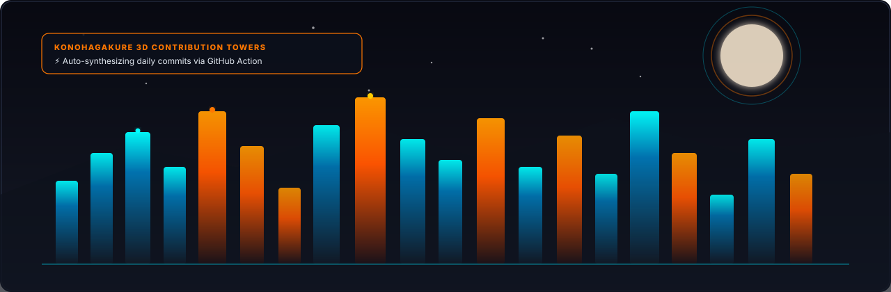

<div align="center">

<!-- ═══════════════════ 💀 BLACK HAT MAINFRAME HERO ═══════════════════ -->


<br/><br/>

<!-- ═══════════════════ 📂 CLASSIFIED DOSSIER ═══════════════════ -->


<br/><br/>

<!-- ═══════════════════ ⚡ WEAPONIZED ARSENAL (TECH STACK) ═══════════════════ -->


<br/><br/>

<!-- ═══════════════════ 🪪 OPERATOR CLEARANCE BADGE ═══════════════════ -->


<br/><br/>

</div>

---

### 🛰️ Verified Payload Deployments // Active Repositories

<table>
  <thead>
    <tr>
      <th align="left">🎯 Target / Repository</th>
      <th align="left">🔍 Intelligence &amp; Technical Capabilities</th>
      <th align="center">⚡ Technology Stack</th>
      <th align="center">🔗 Direct Uplink</th>
    </tr>
  </thead>
  <tbody>
    <tr>
      <td>
        <a href="https://github.com/divyanshusrivastava2k3/resume-matcher">
          <b>🤖 resume-matcher</b>
        </a>
      </td>
      <td>
        <b>AI Candidate-Job Alignment &amp; Skill Distance Engine:</b> Leverages high-dimensional TF-IDF vectorization, Cosine Similarity algorithms, and automated skill-gap evaluation to rank candidate fitness against job descriptions in milliseconds.
      </td>
      <td align="center">
        <code>Python</code> <code>Flask</code> <code>Scikit-learn</code> <code>NLP</code>
      </td>
      <td align="center">
        <a href="https://github.com/divyanshusrivastava2k3/resume-matcher"><b>[Repository]</b></a>
      </td>
    </tr>
    <tr>
      <td>
        <a href="https://github.com/divyanshusrivastava2k3/sentiment-analyzer">
          <b>🧠 sentiment-analyzer</b>
        </a>
      </td>
      <td>
        <b>Neural Emotion &amp; Sentiment Classification Pipeline:</b> Production deep-learning inference driven by Hugging Face Transformers (RoBERTa), backed by MongoDB persistent query storage and interactive Chart.js analytics.
      </td>
      <td align="center">
        <code>RoBERTa</code> <code>Transformers</code> <code>MongoDB</code> <code>Chart.js</code>
      </td>
      <td align="center">
        <a href="https://github.com/divyanshusrivastava2k3/sentiment-analyzer"><b>[Repository]</b></a>
      </td>
    </tr>
    <tr>
      <td>
        <a href="https://github.com/divyanshusrivastava2k3/secure-auth-system">
          <b>🛡️ secure-auth-system</b>
        </a>
      </td>
      <td>
        <b>Zero-Trust Identity &amp; Cryptographic Vault:</b> Hardened security pipeline utilizing PyJWT signed token handshakes, salt-hashed Bcrypt credentials, session integrity guards, and secure PostgreSQL/SQLite integration.
      </td>
      <td align="center">
        <code>Python</code> <code>PyJWT</code> <code>Bcrypt</code> <code>PostgreSQL</code>
      </td>
      <td align="center">
        <a href="https://github.com/divyanshusrivastava2k3/secure-auth-system"><b>[Repository]</b></a>
      </td>
    </tr>
    <tr>
      <td>
        <a href="https://github.com/divyanshusrivastava2k3/reelnova">
          <b>⚡ reelnova</b>
        </a>
      </td>
      <td>
        <b>High-Throughput Media Intercept Platform:</b> Modern web architecture designed for rapid extraction and parsing of digital video feeds with high responsiveness and low overhead.
      </td>
      <td align="center">
        <code>TypeScript</code> <code>Next.js</code> <code>Web APIs</code>
      </td>
      <td align="center">
        <a href="https://www.reelnova.in/"><b>[Live Intercept]</b></a>
      </td>
    </tr>
    <tr>
      <td>
        <a href="https://github.com/divyanshusrivastava2k3/ChatD">
          <b>💬 ChatD</b>
        </a>
      </td>
      <td>
        <b>Encrypted Realtime Telepathic Socket:</b> Ultra low-latency bidirectional messaging channel with instant packet broadcast, distributed client state synchronization, and sleek dark UI.
      </td>
      <td align="center">
        <code>JavaScript</code> <code>WebSockets</code> <code>Node.js</code>
      </td>
      <td align="center">
        <a href="https://github.com/divyanshusrivastava2k3/ChatD"><b>[Repository]</b></a>
      </td>
    </tr>
    <tr>
      <td>
        <a href="https://github.com/divyanshusrivastava2k3/PORT_folio">
          <b>🌐 PORT_folio</b>
        </a>
      </td>
      <td>
        <b>Mainframe Developer Showcase:</b> Production glassmorphism terminal highlighting live web engineering projects, technical competencies, and secure comms links.
      </td>
      <td align="center">
        <code>HTML5</code> <code>CSS3</code> <code>Vercel</code>
      </td>
      <td align="center">
        <a href="https://divyanshu-srivastava-flax.vercel.app"><b>[Live Node]</b></a>
      </td>
    </tr>
  </tbody>
</table>

<br/>

<div align="center">
  <a href="https://github.com/divyanshusrivastava2k3?tab=repositories">
    <b>⚡ [ACCESS_ALL_REPOSITORIES] Inspect Complete Source Code Tree →</b>
  </a>
</div>

<br/><br/>

---

<div align="center">

<!-- ═══════════════════ 📊 LIVE TERMINAL TELEMETRY ═══════════════════ -->
### 📊 Mainframe Telemetry &amp; Commit Activity

<p align="center">
  
  
</p>

<p align="center">
  
</p>

<br/>

<!-- ═══════════════════ 🌃 3D RECONSTRUCTION GRID ═══════════════════ -->
### 🌃 Commit Reconstruction Grid // Daily Sync

*Automated neural telemetry log generated every 24 hours.*



<br/><br/>

<!-- ═══════════════════ 📡 SECURE TRANSMISSION FREQUENCIES ═══════════════════ -->


<br/>

<!-- Cyberpunk Terminal Badges -->
<a href="https://divyanshu-srivastava-flax.vercel.app" target="_blank">
  
</a>
&nbsp;
<a href="https://github.com/divyanshusrivastava2k3" target="_blank">
  
</a>
&nbsp;
<a href="https://www.linkedin.com" target="_blank">
  
</a>
&nbsp;
<a href="mailto:divyanshu@example.com">
  
</a>

<br/><br/>

<!-- Access Log Counter -->


<br/><br/>

```bash
// [SYSTEM_OVERRIDE]: "I build hardened software architectures and break complex problems with clean code."
// [STATUS]: ROOT ACCESS GRANTED | STEALTH MODE: ACTIVE
```

</div>
