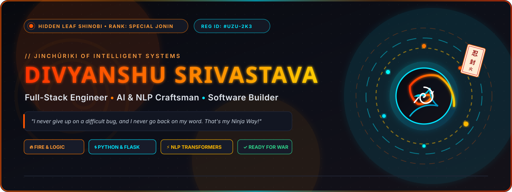
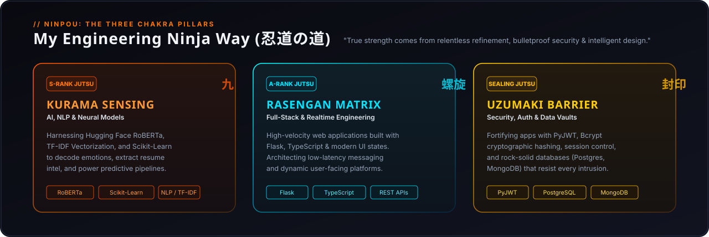
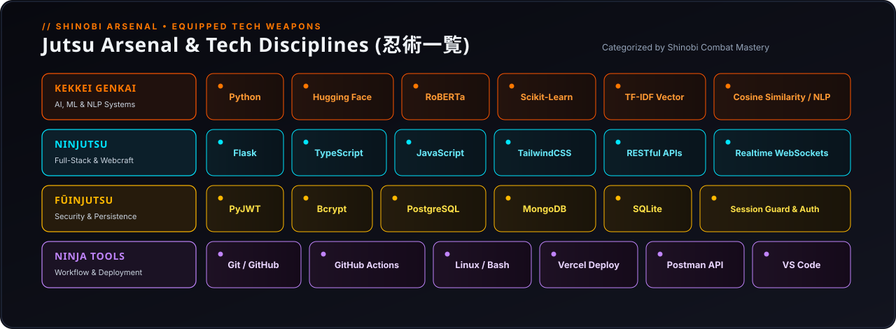
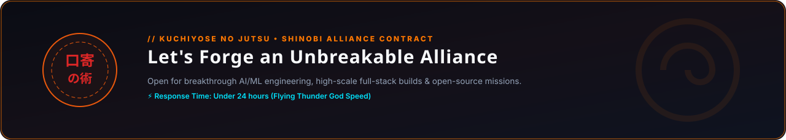

<!-- ═══════════════════ ⚡ HERO BANNER ═══════════════════ -->

  

  

<!-- ═══════════════════ 📜 THE 3 CHAKRA PILLARS ═══════════════════ -->

  

<!-- ═══════════════════ ⚡ JUTSU ARSENAL (TECH STACK) ═══════════════════ -->

  

<!-- ═══════════════════ 🪪 OFFICIAL SHINOBI PASSPORT & STATS ═══════════════════ -->

  

---

### 🍥 S-Rank &amp; A-Rank Missions (Featured Projects)

<table>
  <thead>
    <tr>
      <th align="left">📜 Mission / Project</th>
      <th align="left">🎯 Mission Intel (What it does)</th>
      <th align="center">⚡ Jutsu Used</th>
      <th align="center">🔗 Access</th>
    </tr>
  </thead>
  <tbody>
    <tr>
      <td>
        <a href="https://github.com/divyanshusrivastava2k3/resume-matcher">
          <b>🤖 Resume-Job Matcher</b>
        </a>
      </td>
      <td>
        <b>AI-Powered Candidate-Job Matching Engine:</b> Leverages TF-IDF vectorization, Cosine Similarity &amp; Skill Gap Analysis to evaluate candidate-role suitability in milliseconds.
      </td>
      <td align="center">
        <code>Python</code> <code>Flask</code> <code>Scikit-learn</code> <code>NLP</code>
      </td>
      <td align="center">
        <a href="https://github.com/divyanshusrivastava2k3/resume-matcher"><b>[Repository]</b></a>
      </td>
    </tr>
    <tr>
      <td>
        <a href="https://github.com/divyanshusrivastava2k3/sentiment-analyzer">
          <b>🧠 Sentiment Analyzer</b>
        </a>
      </td>
      <td>
        <b>Neural Emotion &amp; Sentiment Classifier:</b> Deep learning inference using Hugging Face Transformers (RoBERTa), backed by MongoDB persistence and interactive Chart.js analytics.
      </td>
      <td align="center">
        <code>RoBERTa</code> <code>Transformers</code> <code>MongoDB</code> <code>Chart.js</code>
      </td>
      <td align="center">
        <a href="https://github.com/divyanshusrivastava2k3/sentiment-analyzer"><b>[Repository]</b></a>
      </td>
    </tr>
    <tr>
      <td>
        <a href="https://github.com/divyanshusrivastava2k3/secure-auth-system">
          <b>🛡️ Secure Auth System</b>
        </a>
      </td>
      <td>
        <b>Production-Grade Authentication Vault:</b> High-security user authentication with PyJWT tokens, Bcrypt password hashing, session guards, and PostgreSQL/SQLite integration.
      </td>
      <td align="center">
        <code>Python</code> <code>PyJWT</code> <code>Bcrypt</code> <code>PostgreSQL</code>
      </td>
      <td align="center">
        <a href="https://github.com/divyanshusrivastava2k3/secure-auth-system"><b>[Repository]</b></a>
      </td>
    </tr>
    <tr>
      <td>
        <a href="https://github.com/divyanshusrivastava2k3/reelnova">
          <b>⚡ ReelNova</b>
        </a>
      </td>
      <td>
        <b>Fast Media Downloader Platform:</b> Modern web application engineered for seamless video &amp; media extraction with high responsiveness and custom web architecture.
      </td>
      <td align="center">
        <code>TypeScript</code> <code>Next.js</code> <code>Web APIs</code>
      </td>
      <td align="center">
        <a href="https://www.reelnova.in/"><b>[Live Site]</b></a>
      </td>
    </tr>
    <tr>
      <td>
        <a href="https://github.com/divyanshusrivastava2k3/ChatD">
          <b>💬 ChatD</b>
        </a>
      </td>
      <td>
        <b>Low-Latency Messaging Webapp:</b> Realtime telepathic communication portal with instant packet transmission, multi-client synchronization, and sleek UI.
      </td>
      <td align="center">
        <code>JavaScript</code> <code>WebSockets</code> <code>Node.js</code>
      </td>
      <td align="center">
        <a href="https://github.com/divyanshusrivastava2k3/ChatD"><b>[Repository]</b></a>
      </td>
    </tr>
    <tr>
      <td>
        <a href="https://github.com/divyanshusrivastava2k3/PORT_folio">
          <b>🌐 Personal Portfolio</b>
        </a>
      </td>
      <td>
        <b>Interactive Shinobi Developer Hub:</b> Modern glassmorphism showcase highlighting production projects, technical prowess, and contact links.
      </td>
      <td align="center">
        <code>HTML5</code> <code>CSS3</code> <code>Vercel</code>
      </td>
      <td align="center">
        <a href="https://divyanshu-srivastava-flax.vercel.app"><b>[Live App]</b></a>
      </td>
    </tr>
  </tbody>
</table>

 

  <a href="https://github.com/divyanshusrivastava2k3?tab=repositories">
    <b>🌀 Explore All Completed Shinobi Missions &amp; Repositories →</b>
  </a>

  

---

<!-- ═══════════════════ 📊 LIVE COMBAT & CHAKRA STATS ═══════════════════ -->
### 📊 Live Chakra &amp; Ninja Activity

  
  

  

 

<!-- ═══════════════════ 🌀 RASENGAN CHARGE ═══════════════════ -->

  

<!-- ═══════════════════ 🌃 3D CONTRIBUTION VILLAGE ═══════════════════ -->
### 🌃 The Hidden Leaf Contribution Village

*Every commit forges another building in Konohagakure — reconstructed automatically every 24 hours.*

  

<!-- ═══════════════════ 📜 SUMMONING SCROLL (CONNECT) ═══════════════════ -->

 

<!-- Social Badges in Naruto Palette -->

&nbsp;

&nbsp;

&nbsp;

  

<!-- Visitor Counter -->

  

 

**"I never go back on my word, and I never give up on complex code. That's my Ninja Way!"** 🍥  
### *Dattebayo! (だってばよ!)*

